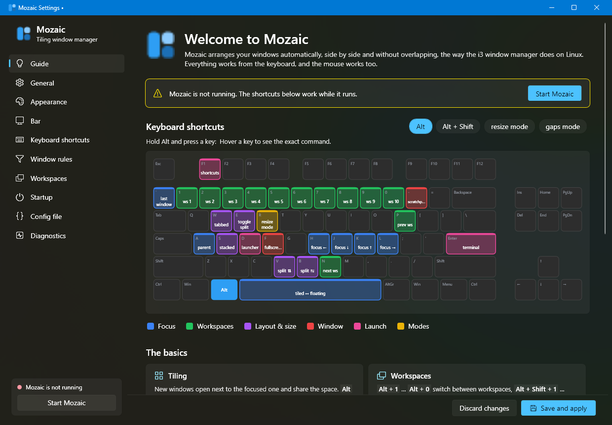
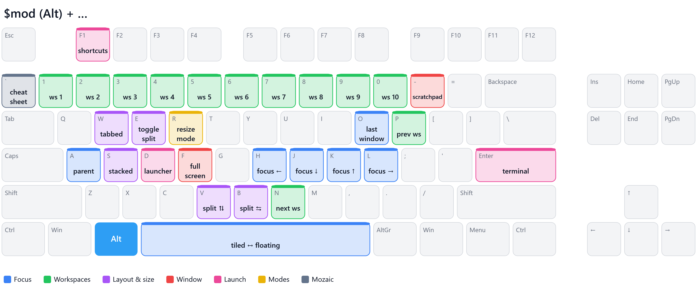
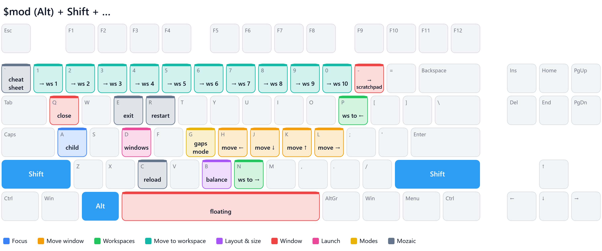
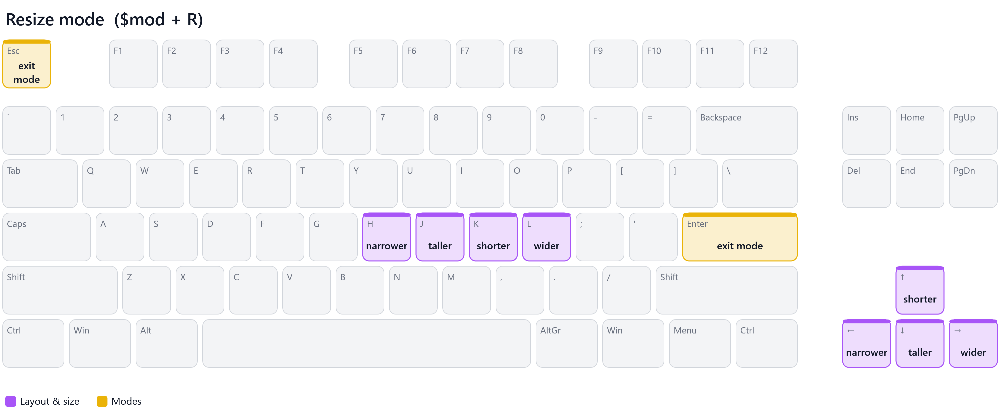
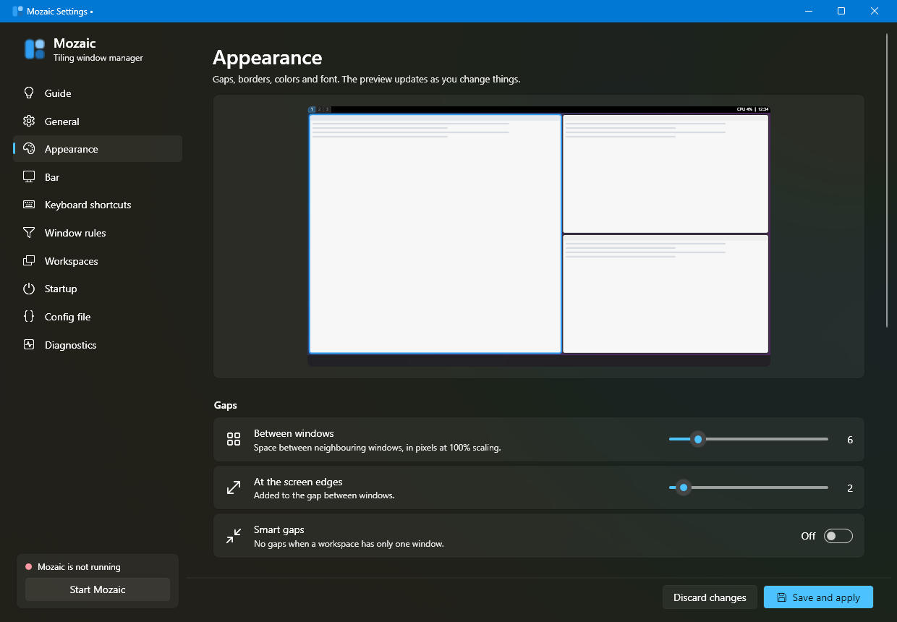

# Mozaic

An **i3-style tiling window manager for Windows 11**. It uses i3's tree model, commands and config
syntax — so your i3 muscle memory (and most of your i3 config) carries over — and adds what you want on
Windows: mouse-driven tiling, Windows 11 border colors, a layout that survives restarts, a built-in launcher,
a graphical settings app with a live keyboard cheat sheet, and crash safety.



- **Mozaic.exe** – the window manager: native single exe (C# + NativeAOT, ~5 MB, no .NET runtime needed),
  pure Win32, no admin rights, per-monitor DPI aware, multi-monitor with hot-plug.
- **MozaicSettings.exe** – settings app (WPF, Windows 11 Fluent look, English/Polish) with the shortcut guide.
- **mozaic-msg.exe** – command-line control, the `i3-msg` equivalent.

## Quick start

Download `Mozaic-<version>-win-x64.zip` from [Releases](https://github.com/kszostek/mozaic/releases/latest), unpack it anywhere and run
`Mozaic.exe`. The exes are not code-signed, so SmartScreen may ask once (*More info* → *Run anyway*).

On first start a commented default config is written to `%USERPROFILE%\.config\mozaic\config` and the
**guide** opens, showing every shortcut on a keyboard. Click the tray icon for the settings; right-click it for
the menu (pause tiling, reload, *Start with Windows*, …).

`MozaicSettings.exe` runs on the .NET 10 Desktop Runtime (Windows offers to install it if missing);
`Mozaic.exe` and `mozaic-msg.exe` need nothing.

To build it yourself:

```powershell
.\build.ps1            # build, run unit tests, publish to .\publish
.\publish\Mozaic.exe   # start it (a tray icon appears, the guide opens)
```

Building needs the .NET 10 SDK and Visual Studio / Build Tools with *Desktop development with C++* (for
NativeAOT).

## Keyboard shortcuts

`$mod` is **Alt** by default (see [Why Alt?](#why-alt-and-not-the-win-key)). These pictures are generated from
the default config — the guide in the settings app draws the same keyboard from *your* config.







Highlights: **hold `` $mod+` ``** to see this keyboard on screen (add Shift for the second layer; it disappears
when you let go) · `$mod+Enter` terminal · `$mod+d` launcher · `$mod+Shift+d` window switcher · `$mod+F1`
searchable list of all shortcuts and commands · `$mod+h/j/k/l` focus, add Shift to move · `$mod+1…0` workspaces ·
`$mod+b`/`$mod+v` split · `$mod+w`/`$mod+s`/`$mod+e` tabbed/stacked/split · `$mod+f` fullscreen ·
`$mod+Shift+space` floating · `$mod+o` previous window · `$mod+r` resize mode · `$mod+Shift+c` reload.

The cheat sheet works with older configs too: unless your config binds `` $mod+` `` / `` $mod+Shift+` `` or uses
`cheatsheet` on other keys, Mozaic binds those two keys for it.

### Mouse

- **Drag a tiled window by its title bar** onto another window: near an edge it is placed next to that window (a
  translucent preview shows where), in the middle the two swap. Drop it on an empty monitor to move it there.
- **Drag the edge of a tiled window** to resize the split — the neighbour shrinks accordingly.
- **`$mod` + left-drag** moves any window, **`$mod` + right-drag** resizes it (tiled windows: live resize).
- Bar: click a workspace to switch, scroll to cycle. Tabs: click to focus, middle-click to close, scroll to switch.

## Settings app

Everything can be changed without touching the config file — and the file keeps your comments and ordering,
because the editor changes only the lines it has to.



| Page | What you can do |
|---|---|
| **Guide** | Keyboard cheat sheet per modifier layer and binding mode (hover a key for the exact command), the basics, *show at startup* |
| **General** | `$mod` (Alt/Win), terminal, autotiling, focus behaviour, mouse dragging, layout memory, on-screen display |
| **Appearance** | Gaps, smart gaps, colored Windows 11 borders, focus frame, corner style, group lines and their color, fading of unused windows, font, window colors — with a live preview |
| **Bar** | Position, height, workspace buttons and app icons, title, status blocks and date format, status program, colors, auto-hide the Windows taskbar |
| **Keyboard shortcuts** | Search, add, edit (press the keys to record them), delete; conflicts are marked |
| **Window rules** | Pick a running window and choose: float, float on every workspace, open on workspace N, don't focus, don't manage, or any commands |
| **Workspaces** | Names (e.g. `2:web`) and the monitor each workspace lives on |
| **Startup** | Start with Windows, programs to run with Mozaic |
| **Config file** | The raw file with i3 syntax highlighting and live error checking |
| **Diagnostics** | Every open window and why it is (not) managed, run any command, reload/restart, log |

*Save and apply* writes the file (keeping a `.bak`) and reloads Mozaic. While you record a shortcut, Mozaic's
hotkeys are paused so it does not swallow the keys.

## How it works (i3 semantics)

Everything follows i3's tree: monitors → workspaces → split/tabbed/stacked containers → windows, each
container with its own focus history. New windows open after the focused one; `split v` then opening a window
nests it; `move` enters and leaves containers exactly like i3's `tree_move`; focusing into a container returns to
its last focused window; empty workspaces disappear when you leave them; gaps follow i3-gaps (outer is added to
inner at the edges). Windows on hidden workspaces and in inactive tabs are hidden, like on Windows' virtual
desktops.

### Better than i3 on Windows

| | |
|---|---|
| **Layout survives restarts and crashes** | The tree is saved continuously; `restart`, a crash or relaunch restores it for windows that still exist. |
| **Never loses a window** | Hidden windows are recorded on disk; if Mozaic is killed, the next start shows them again. Exiting always shows everything. |
| **Autotiling** | Optional spiral layout: new windows split the focused one along its longer side (the popular i3 add-on, built in). |
| **No useless nesting** | Split containers left with one child are flattened automatically. |
| **Windows 11 integration** | Focus shown with the native colored window border, optional square corners, invisible resize borders compensated so gaps are pixel-exact. |
| **Mouse tiling** | Drag-and-drop re-tiling with preview, edge-drag resizing, `$mod`+drag. Snap Assist is dismissed after a tiled drag. |
| **Launcher & command palette** | Fuzzy launcher over the whole Start menu (Store apps too) and `PATH`, ranked by usage; window switcher; `$mod+F1` lists every shortcut and command. |
| **Cheat sheet while you hold the keys** | Hold `` $mod+` `` and every shortcut appears on a keyboard over your windows, colored by what it does; Shift switches to the `$mod+Shift` keys. |
| **See the groups** | Lines in the gaps join the windows of one tile — a part of the workspace you split into several windows (the focused tile brightest). A current flows along them when the focus or layout changes and while `$mod` is held — and costs nothing the rest of the time. Color: `group_lines_color`. |
| **Fade what you aren't using** | The active window is opaque, the one used before it 90%, older ones fade further (down to 70%). Never leaves a window translucent, even if Mozaic is killed. |
| **`focus last`** | Jump back to the previously focused window, on any workspace. |
| **Bar with app icons, OSD** | Workspace buttons show the icons of their apps; switching workspace or mode flashes its name in the middle of the screen. |
| **Diagnostics** | "Why isn't this window tiled?" — every window with Mozaic's reason (elevated, tool window, ignore rule, …). |
| **Apps that fight back** | Windows that move themselves are put back; native fullscreen (F11, video, games) and maximize are respected. |
| **Minimize-aware, urgency** | Minimizing removes a window from the layout and restoring puts it back; flashing windows mark their workspace urgent. |

## Configuration

The config is i3 syntax: `set`, `bindsym`/`bindcode` (`--release`), `mode "name" { … }`, `exec`/`exec_always`,
`for_window`, `assign`, `no_focus`, `workspace N output X`, `gaps`, `smart_gaps`, `default_border`,
`default_orientation`, `workspace_layout`, `focus_follows_mouse`, `mouse_warping`, `focus_wrapping`,
`workspace_auto_back_and_forth`, `focus_on_window_activation`, `floating_modifier`, `client.*` colors, `font`,
`include`, and `bar { … }` with `colors { … }`. X11-only directives are accepted and ignored, so existing i3
configs load; real mistakes are shown in a notification, in the bar and in the settings app.

Windows-specific notes:

- **Criteria**: `class` matches the window class *or* the process name (`[class="firefox"]` works),
  `process`/`exe`/`instance` match the process name (with or without `.exe`, case-insensitive), `title` is a
  case-sensitive regex like in i3. Also `window_type="dialog"`, `floating`, `tiling`, `con_mark`, `id`, `con_id`,
  `urgent`. Values may use `"double"` or `'single'` quotes.
- **Outputs** are named `DISPLAY1`, `DISPLAY2`, … (see `mozaic-msg -t get_outputs`), `primary`, or by position `1`, `2`.
- **Keys**: X keysym names (`Return`, `space`, `minus`, `grave`, `F1`, `XF86AudioMute`, …) map to virtual keys of
  your keyboard layout. `bindcode` takes a Windows virtual-key code.

Extensions (all optional):

```
autotiling no                     # spiral tiling
osd yes                           # show workspace / mode name when it changes
welcome yes                       # open the shortcut guide when Mozaic starts
group_lines on                    # on | always (current flows all the time) | off
group_lines_color #2e9ef4         # default: the client.focused indicator color
inactive_opacity 90 70            # previously used window %, oldest windows %; or off
opacity_ignore [process="^mpv$"]  # windows that always stay opaque
ignore [process="SomeOverlay"]    # never manage matching windows
window_border_colors yes          # color native borders with client.* child_border colors
corner_style default              # default | square | round | small
floating_always_on_top yes
flatten_containers yes
tiling_drag on
remember_layout yes

bar {
    status_blocks "cpu memory battery disk datetime"
    datetime_format "ddd d MMM  HH:mm"     # .NET format, your locale
    status_command <program>               # or any i3bar-protocol / plain-text status program
    workspace_icons yes
    show_title yes
}
```

Extra commands: `cheatsheet [show|hide|toggle]` (bound to a key: shown while the key is held), `focus last`, `balance`,
`launcher [apps|windows|commands]`, `settings`, `confirm "question?" <command>`,
`pause [on|off]`, `retile`, `hotkeys on|off`.

## mozaic-msg

The `i3-msg` equivalent (same message types, JSON replies, named pipe per user session):

```powershell
mozaic-msg workspace 3
mozaic-msg "[process=firefox] move container to workspace 2; workspace 2"
mozaic-msg -t get_tree
mozaic-msg -t get_candidates      # every window and why it is / isn't managed
mozaic-msg -t subscribe '["window","mode"]'
```

## Why Alt and not the Win key?

Windows reserves many Win combinations (Win+L locks the session and can never be intercepted, Win+Space switches
the input language). Alt avoids those; Mozaic swallows only the combinations you bind and injects a dummy key so
releasing Alt/Win never opens a menu bar or the Start menu. To use Win, pick it on the *General* page (or
`set $mod Win`).

## Tips & limitations

- **Elevated windows** (e.g. Task Manager) can't be controlled by a non-elevated process, and Windows doesn't
  deliver hotkeys to Mozaic while one has focus. Run Mozaic as administrator if you want them tiled.
- Windows' *Snap layouts* flyout (dragging to the top of the screen) can be turned off in Settings → System →
  Multitasking.
- Use either Mozaic workspaces or Windows virtual desktops.
- The settings app renders in software by default (some GPU drivers show an empty WPF window); set
  `MOZAIC_RENDER=hardware` to use the GPU. `MOZAIC_LANG=en|pl` overrides the UI language.
- Files: config `%USERPROFILE%\.config\mozaic\config`; log, saved layout and launcher history in
  `%LOCALAPPDATA%\Mozaic`. `Mozaic.exe --dry-run --dump tree.json` shows what would be managed without touching
  anything; `--debug` enables verbose logging.

## Development

```
src/Mozaic.Core      pure logic: i3 tree, layout engine, config + command parsers, lossless config editing
src/Mozaic           Win32 layer: hooks, window control, sync engine, bar, tabs, OSD, cheat sheet, group lines,
                     opacity, tray, launcher, IPC
src/MozaicSettings   WPF settings app and keyboard guide
src/MozaicMsg        mozaic-msg CLI
src/Shared           code linked into both apps (IPC protocol, translations, keyboard labels)
tests/               xUnit tests + live end-to-end tests
```

```powershell
dotnet test tests/Mozaic.Tests                 # 71 unit tests (tree, layout, group lines, parsers, config editing)
powershell -File tests\live-test.ps1          # 55 checks against real windows (isolated instance)
powershell -File tests\input-test.ps1         # hotkeys, cheat sheet, title-bar drag, $mod+drag, edge resize
```

The live tests run a separate instance (`--instance test --manage-only ^MZTEST --no-hotkeys`) that only manages
its own test windows and aborts if anything else would be managed. The test windows use Mozaic's own window
class, so a Mozaic that manages your desktop at the same time ignores them. `input-test.ps1` moves the mouse and
sends keys for a few seconds; with `-KeysOnly` it skips the mouse part (use that while your own Mozaic is
running, since a drag could land on one of its windows).

`MozaicSettings.exe --page appearance --render-to page.png [--render-height 2300]` renders a settings page to a
PNG without opening a window (for documentation and checks).

GitHub Actions builds and unit-tests every push. To publish a release, push a version tag — the workflow builds
`Mozaic-<version>-win-x64.zip` and creates the release with the notes from `.github/release-notes.md`:

```powershell
git tag v0.2.0
git push origin v0.2.0
```
